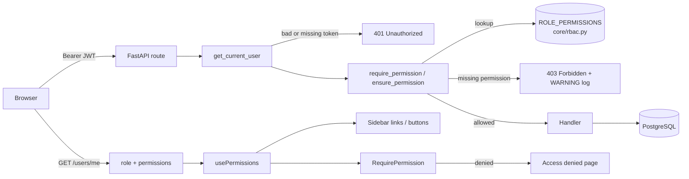

# Full Stack FastAPI Template

## Role-Based Access Control (RBAC)

This fork adds three roles — **admin**, **manager** and **member** — enforced in the API and mirrored in the UI.

### Quick start

Only Docker is required. The frontend dev server additionally needs Node.js `^20.19` or `>=22.12` (Vite 8); the repo's `.nvmrc` pins 22, so run `nvm install && nvm use`.

1. `docker compose build backend`
2. `docker compose run --rm backend bash scripts/prestart.sh` — runs the migrations and seeds the three demo accounts below.
3. `docker compose up -d --wait backend`
4. Open <http://localhost:8000> (built frontend) or <http://localhost:8000/docs> (API docs).
5. Optional, frontend dev server with hot reload, from the repo root: `nvm use`, then `bun install && bun run dev` → <http://localhost:5173>. No Bun installed? `npx bun install && cd frontend && npx vite`. No local Node either? `.claude/scripts/dev.sh up` runs everything, including the dev server, in Docker.

### Demo accounts

| Email | Role | Password |
|---|---|---|
| `admin@example.com` | admin | `FIRST_SUPERUSER_PASSWORD` in `.env` |
| `manager@example.com` | manager | `DEMO_USER_PASSWORD` (default `changethis`) |
| `member@example.com` | member | `DEMO_USER_PASSWORD` (default `changethis`) |

The manager and member accounts share a well-known password, so they are seeded **only in development**: when `FASTAPI_ENV=development` *and* `DEMO_USER_PASSWORD` is set. Both are set in `compose.override.yml`, which Docker Compose applies locally but deployments skip (they use `-f compose.yml -f compose.deploy.yml`). `DEMO_USER_PASSWORD` is deliberately not in the tracked `.env`, so no deploy path can pick it up. Seeding is idempotent: re-run step 2 at any time to restore missing accounts.

Running the backend without Docker (`uv`)? Pass the password explicitly: `cd backend && DEMO_USER_PASSWORD=changethis uv run bash scripts/prestart.sh`.

### Permission matrix

| Action | admin | manager | member |
|---|:-:|:-:|:-:|
| View / update own profile and password | ✓ | ✓ | ✓ |
| Manage own items | ✓ | ✓ | ✓ |
| List all users, view any user | ✓ | ✓ | ✗ |
| View metrics | ✓ | ✓ | ✗ |
| Create user (and choose their role) | ✓ | ✗ | ✗ |
| Update any user / change role | ✓ | ✗ | ✗ |
| Delete any user | ✓ | ✗ | ✗ |
| Global settings (test email, email previews) | ✓ | ✗ | ✗ |
| Manage everyone's items | ✓ | ✗ | ✗ |
| Delete own account | ✗ ¹ | ✓ | ✓ |

¹ Admins can't delete themselves or change their own role, so the system can't be locked out by accident.

| Endpoint | Requires |
|---|---|
| `GET /api/v1/users/` | `users:read` |
| `GET /api/v1/users/{id}` | self, or `users:read` |
| `POST /api/v1/users/` | `users:create` |
| `PATCH /api/v1/users/{id}` | `users:update` |
| `DELETE /api/v1/users/{id}` | `users:delete` |
| `GET /api/v1/metrics/` | `metrics:read` |
| `POST /api/v1/utils/test-email/`, `POST /api/v1/password-recovery-html-content/{email}` | `settings:manage` |
| `/api/v1/items/*` | owner, or `items:manage_all` |
| `/api/v1/users/me*` | any authenticated user |

### How authorization works

Roles are bundles of permissions, and **code only ever checks permissions**. The whole policy lives in one file, [`backend/app/core/rbac.py`](backend/app/core/rbac.py): a `Role` enum, a `Permission` enum (`resource:action`), and a `ROLE_PERMISSIONS` dict mapping each role to its permissions. Anything not listed is denied.

Checks live in FastAPI dependencies in [`backend/app/api/deps.py`](backend/app/api/deps.py), not in middleware or custom decorators. Static checks are declared on the route — `dependencies=[Depends(require_permission(Permission.USERS_READ))]` — so each endpoint's requirement is visible in its signature and in OpenAPI. When the answer depends on the loaded resource ("yourself, or anyone with `users:read`"; "the item's owner, or `items:manage_all`"), the handler calls `ensure_permission` / `has_permission`. A missing or invalid token returns **401**; an authenticated user without the permission gets **403**, and the denial is logged at `WARNING` with user id, role and permission. Authorization runs before existence checks, so a 404 never reveals whether a forbidden resource exists.

The role is stored on the user as `user.role` (`VARCHAR(20)`, default `member`) and validated by the `Role` enum at the API boundary. Only admins can set it (`POST /users/`, `PATCH /users/{id}`); the signup and "update my profile" schemas don't have a `role` field, so self-escalation isn't possible.

The frontend never re-implements the matrix. `GET /users/me` returns the user's `role` and a computed `permissions` list; `usePermissions().can("users:read")` and `<RequirePermission>` use it to hide navigation links and buttons, and a page opened directly without permission renders an **Access denied** view instead of failing silently. Only a 401 logs the user out. The UI is a convenience — the backend is the enforcement point.

Design decisions are recorded in [ADR-0001](docs/adr/0001-permission-checks-as-fastapi-dependencies.md) and [ADR-0002](docs/adr/0002-role-storage-and-frontend-capabilities.md).

### Running tests

- Backend: `.claude/scripts/dev.sh test` (Docker only), or `cd backend && uv run bash scripts/test.sh` with a local uv. The authorization suite is [`backend/tests/api/routes/test_rbac.py`](backend/tests/api/routes/test_rbac.py): allowed and denied access per role for listing users, creating users, metrics and own profile, plus self-escalation via signup and profile update, admin self-demotion, managers editing users, managers blocked from global settings and from other users' items, 401 for missing/invalid tokens, and logging of denials. [`backend/tests/crud/test_init_db.py`](backend/tests/crud/test_init_db.py) proves the demo accounts are never seeded outside development.
- The test session deletes all users when it finishes. `dev.sh test` re-seeds automatically; otherwise re-run the seed step from the quick start.
- Frontend end-to-end (optional, stack running): `bunx playwright test` from `frontend/`. [`frontend/tests/rbac.spec.ts`](frontend/tests/rbac.spec.ts) logs in as a manager (sidebar links, read-only Users page, Metrics page) and as a member (no links, Access denied on direct navigation, still logged in).

### Database migration

Migration `b6df181d0cf8` adds `user.role`, sets it to `admin` for every former superuser, then drops `is_superuser`. It is reversible with `alembic downgrade -1`, and `scripts/prestart.sh` applies it automatically.

### Adding a role or permission

1. Add it to `Role` / `Permission` and to `ROLE_PERMISSIONS` in `backend/app/core/rbac.py`.
2. Add the display label to `ROLE_LABELS` in `frontend/src/lib/roles.ts` — TypeScript fails until you do.
3. Guard any new endpoint with `require_permission(...)`, and gate its UI with the same permission string.
4. Regenerate the frontend client (`bash ./scripts/generate-client.sh` or `.claude/scripts/dev.sh client`).
5. Add rows to `test_rbac.py` and to the matrix above.

No database migration is needed for a new role. With Claude Code, `/add-role <name>` does all of this.

## Technology Stack and Features

- ⚡ [**FastAPI**](https://fastapi.tiangolo.com) for the Python backend API.
  - 🧰 [SQLModel](https://sqlmodel.tiangolo.com) for the Python SQL database interactions (ORM).
  - 🔍 [Pydantic](https://docs.pydantic.dev), used by FastAPI, for the data validation and settings management.
  - 💾 [PostgreSQL](https://www.postgresql.org) as the SQL database.
- 🚀 [React](https://react.dev) for the frontend.
  - 🧩 Built into the backend application and served by FastAPI on the same domain as the API.
  - 💃 Using TypeScript, hooks, [Vite](https://vitejs.dev), and other parts of a modern frontend stack.
  - 🎨 [Tailwind CSS](https://tailwindcss.com) and [shadcn/ui](https://ui.shadcn.com) for the frontend components.
  - 🤖 An automatically generated frontend client.
  - 🧪 [Playwright](https://playwright.dev) for end-to-end testing.
  - 🦇 Dark mode support.
- ☁️ [FastAPI Cloud](https://fastapicloud.com) for deployment.
- 🐋 [Docker Compose](https://www.docker.com) for local services and self-hosted deployment.
  - 📞 [Traefik](https://traefik.io) as a reverse proxy with automatic HTTPS.
- 🔒 Secure password hashing by default.
- 🔑 JWT (JSON Web Token) authentication.
- 📫 Email-based password recovery.
- ✉️ [React Email](https://react.email) for email templates.
- 📬 [Mailpit](https://mailpit.axllent.org) for local email testing during development.
- ✅ Tests with [Pytest](https://pytest.org).
- 🏭 CI (continuous integration) and CD (continuous deployment) based on GitHub Actions.

### Dashboard Login

### Dashboard - Admin

### Dashboard - Items

### Dashboard - Dark Mode

### React Email Templates

### Mailpit - Local Email Testing

### Interactive API Documentation

## How to Use It

Click the **Use this template** button at the top of this page to create a new repository.

## Backend Development

Backend docs: [backend/README.md](./backend/README.md).

## Frontend Development

Frontend docs: [frontend/README.md](./frontend/README.md).

## Deployment

FastAPI Cloud deployment: [deployment.md](./deployment.md).

Self-hosted deployment with Docker Compose: [deployment-docker-compose.md](./deployment-docker-compose.md).

## Development

General development docs: [development.md](./development.md).

This includes the local FastAPI and Vite workflow, Docker Compose services, `.env` configuration, and more.

## Release Notes

Check the file [release-notes.md](./release-notes.md).

## License

The Full Stack FastAPI Template is licensed under the terms of the MIT license.
